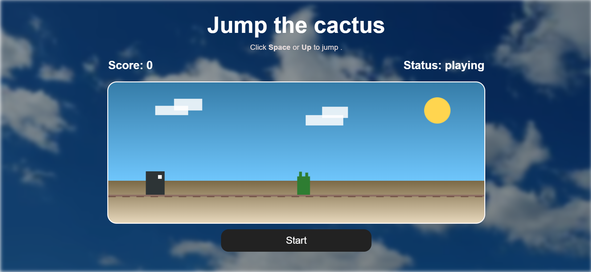
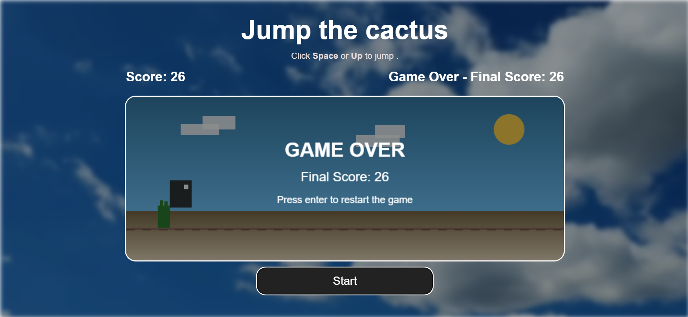

# 🌵 Jumper

A fast, simple 2D endless-runner game built with vanilla JavaScript and the HTML5 Canvas. Jump over cacti, rack up points, and see how long you can survive as the game keeps getting faster.

**▶️ [Play it live](https://gift1400.github.io/Jumper/)**

---

## Screenshots

| Start screen | Gameplay | Game over |
|:---:|:---:|:---:|
|  |  |  |

---

## Features

- **Simple controls**: one key to jump, one key to restart
- **Dynamic scoring**: your score climbs the longer you survive
- **Increasing difficulty**: the game speeds up over time
- **Quick restart**: jump straight back in after a Game Over
- **No dependencies**: just HTML, CSS and JavaScript

## Controls

| Key | Action |
|---|---|
| `Space` or `↑` | Jump |
| `Enter` | Restart after Game Over |

## How It Works

- **Physics**: gravity pulls the player down, and jumping is only possible while on the ground
- **Collision detection**: AABB (axis-aligned bounding box) checks between the player and obstacles
- **Game loop**: driven by `requestAnimationFrame` for smooth rendering

## Tech Stack

- HTML5 (`<canvas>`)
- CSS3
- Vanilla JavaScript
- Docker + Nginx (optional, for containerized hosting)

## Getting Started

### Run locally

```bash
git clone https://github.com/Gift1400/Jumper.git
cd Jumper
```

Open `index.html` in a modern browser (Chrome, Firefox or Edge) and click **Start**.

### Run with Docker

```bash
docker build -t jumper .
docker run -p 8080:80 jumper
```

Then visit [http://localhost:8080](http://localhost:8080).

## Project Structure

```
Jumper/
├── index.html            # Landing page with the Start button
├── pages/
│   └── jumper-game.html  # Game page
├── style/
│   ├── index.css
│   └── jumper-game.css
├── script/
│   └── jumper.js         # Game logic
├── background/           # Background assets
├── screenshots/          # README screenshots
├── Dockerfile
└── .dockerignore
```

## Author

Built by [Gift1400](https://github.com/Gift1400).
